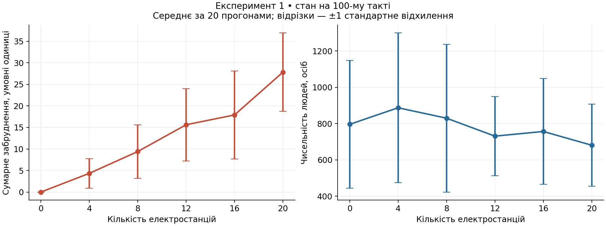
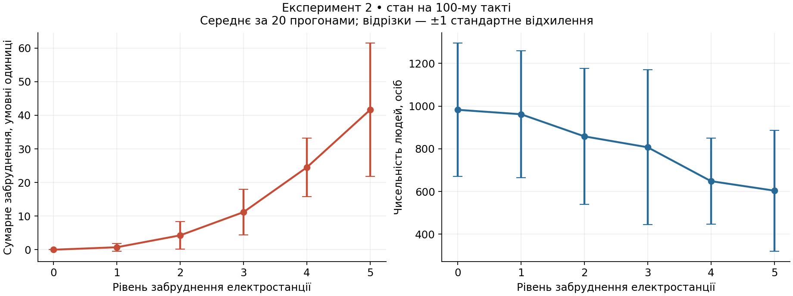
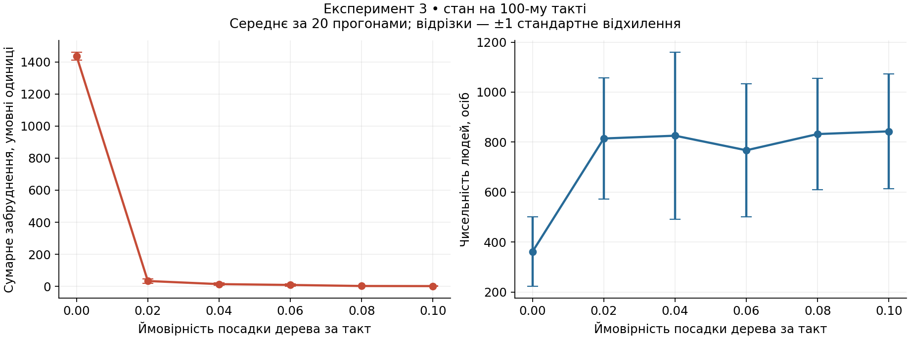

## Комп'ютерні системи імітаційного моделювання
## Група: СПм-25-1, Волинець Кирило Михайлович
### Лабораторна робота №1. Опис імітаційних моделей та проведення обчислювальних експериментів

 

### Варіант 4, модель у середовищі NetLogo:

[Urban Suite — Pollution](https://www.netlogoweb.org/launch#https://www.netlogoweb.org/assets/modelslib/Curricular%20Models/Urban%20Suite/Urban%20Suite%20-%20Pollution.nlogo)

### Мета роботи

Ознайомитися з інтерфейсом NetLogo, описати агентну імітаційну модель забруднення довкілля та експериментально дослідити залежність її показників від керуючих параметрів.

### Вербальний опис моделі

Модель відображає взаємодію населення, джерел забруднення та засобів очищення повітря на умовній міській території. Люди переміщуються, втрачають здоров'я з часом і через забруднення, можуть народжувати дітей та саджати дерева. Електростанції підтримують заданий рівень забруднення у своїх клітинах, звідки воно поширюється на сусідні ділянки. Дерева очищують клітину, на якій розташовані, та її найближче оточення.

Люди (`people`) та дерева (`trees`) — два типи агентів. Електростанції — позначені клітини простору (`patches`), а забруднення — числова змінна клітини, а не окремий рухомий агент. Дерева узагальнено представляють будь-які локальні механізми очищення.

Світ складається з **71 × 63 = 4473 клітин**: координати x від −35 до 35, y від −31 до 31. Простір замкнений по обох осях: при переході через край агент потрапляє на протилежний бік. Один такт відповідає одному кроку модельного часу; інтерфейс позначає його як рік, але це умовний масштаб, не калібрована демографічна модель.

### Інтерфейс і запуск

- Повзунки задають п'ять керуючих параметрів.
- **setup** очищує попередній стан, розміщує електростанції й людей та встановлює час у 0.
- **go** вмикає або призупиняє послідовне виконання тактів. За відсутності людей модель зупиняється.
- На полі чорні фігурки позначають людей, зелені — дерева; колір клітин показує забруднення, а ділянки очищення підсвічуються зеленим.
- Монітор **count people** показує поточну чисельність населення. Графік **World Status** відображає людей, дерева та сумарне забруднення.

### Керуючі параметри

| Параметр | Зміст | Діапазон; крок | За замовчуванням |
|---|---|---|---:|
| `initial-population` | Початкова кількість людей | 0–100; 10 | 30 |
| `birth-rate` | Ймовірність народження одного нащадка за такт для людини з достатнім здоров'ям | 0–0,20; 0,01 | 0,10 |
| `planting-rate` | Ймовірність посадки одного дерева людиною за такт | 0–0,10; 0,01 | 0,05 |
| `power-plants` | Кількість клітин-електростанцій, випадково вибраних без повторень | 0–20; 1 | 2 |
| `polluting-rate` | Значення забруднення, яке встановлюється у клітині електростанції | 0–5; 1 | 3 |

`initial-population` і `power-plants` застосовуються під час `setup`; для дослідження нового значення потрібна повторна ініціалізація. Інші три параметри використовуються під час виконання моделі. У проведених експериментах усі параметри залишалися незмінними протягом кожного прогону.

### Внутрішні параметри та змінні стану

| Змінна або константа | Призначення |
|---|---|
| `health` | Здоров'я людини або дерева; початкове значення — 5 |
| `pollution` | Поточний невід'ємний рівень забруднення клітини |
| `is-power-plant?` | Ознака розміщення електростанції у клітині |
| Положення та напрямок людини | Визначають наступне переміщення й локальний вплив забруднення |
| `ticks` | Кількість виконаних тактів |
| 0,1 | Зменшення здоров'я людини після переміщення та дерева після очищення |
| 4 | Поріг розмноження: після переміщення має виконуватися **`health > 4`** |
| 0,5 | Поріг шкідливого впливу: якщо `pollution > 0.5`, здоров'я додатково зменшується на `pollution / 10` |
| 0,8 | Частка забруднення клітини, яка розподіляється між вісьмома сусідами за один такт |
| 1 та 0,5 | Очищення одним деревом своєї клітини й кожної сусідньої клітини відповідно |

### Показники роботи системи

- **N(t) = `count people`** — чисельність населення.
- **T(t) = `count trees`** — кількість дерев.
- **P(t) = `sum [pollution] of patches`** — сумарне забруднення світу в умовних одиницях.
- Додатково можна обчислювати середній рівень забруднення клітини як P(t)/4473 та час до зникнення населення.

У цій роботі основний показник — **P(100)**, допоміжні — **N(100)** та **T(100)**. Менше забруднення означає кращий результат за екологічним критерієм; збереження населення характеризує життєздатність системи на обраному горизонті. Це не доводить її довгострокової стійкості.

### Алгоритм зміни станів моделі

**Ініціалізація (`setup`):**

1. Видаляються агенти й попередні значення стану; забруднення клітин встановлюється в 0.
2. Випадково вибираються `power-plants` різних клітин. У них встановлюється забруднення `polluting-rate`.
3. Створюються `initial-population` людей із випадковими координатами й напрямками, здоров'ям 5. Дерев спочатку немає.
4. Лічильник часу встановлюється в 0.

**Один такт (`go`):**

1. Якщо людей не залишилося, виконання зупиняється.
2. Люди обробляються у випадковому порядку. Кожна людина:
   - повертається праворуч на випадковий кут від 0 до 50° і ліворуч на незалежний випадковий кут такого самого діапазону, після чого рухається вперед на одну одиницю;
   - втрачає 0,1 здоров'я;
   - якщо здоров'я перевищує 4, з імовірністю `birth-rate` створює одного нащадка зі здоров'ям 5 у своїй поточній позиції;
   - з імовірністю `planting-rate` саджає дерево зі здоров'ям 5;
   - якщо забруднення поточної клітини перевищує 0,5, додатково втрачає `pollution / 10` здоров'я;
   - гине, якщо здоров'я стало не більше 0.
3. Відбувається дифузія: кожна клітина віддає 80% свого забруднення восьми сусідам порівну. Для замкненого світу це зберігає сумарне забруднення до наступних операцій.
4. У клітинах електростанцій забруднення **перезаписується** значенням `polluting-rate`.
5. Кожне дерево зменшує забруднення своєї клітини на 1, восьми сусідніх — на 0,5, без переходу нижче 0. Далі втрачає 0,1 здоров'я та гине, якщо здоров'я вичерпане.
6. Модельний час збільшується на один такт.

Новонароджені люди не виконують власний цикл поведінки у поточному `ask people`, тоді як щойно посаджені дерева вже беруть участь у наступному `ask trees` цього самого такту. Порядок операцій суттєвий: народження відбувається до впливу поточного забруднення, а очищення — після роботи електростанцій.

### Примітки та недоліки моделі

1. **Назва `polluting-rate` умовна.** Код містить `set pollution polluting-rate`, а не додавання викиду до попереднього значення. Тому показник не можна прямо інтерпретувати як масу викидів за рік. Дерево може очистити й клітину електростанції після цього присвоєння.
2. Немає вітру, різних забруднювачів, рельєфу, природного розпаду та перенесення речовини за межі території. Дифузія однакова в усіх напрямках.
3. Люди не уникають забруднення й не обирають місця посадки. Посадка не має вартості; кілька дерев можуть займати одну клітину. Очищення кількома деревами накопичується, але обмежене нулем.
4. Здоров'я не відновлюється; ресурси, площа проживання та місткість середовища не обмежують населення. Тому збільшення чисельності не слід ототожнювати з реалістичним розвитком міста.
5. У вкладці Info є спрощення: опис порога розмноження як «4 або більше» не збігається зі строгим `health > 4` у коді. Тут використано фактичну логіку програми. Тривалість життя близька до 50 тактів; точна гранична перевірка залежить і від арифметики чисел із рухомою комою.
6. Загальний опис Info використовує аналогію «хижак–жертва», але забруднення не розмножується як окрема популяція й джерела не залежать від кількості людей. Ланцюг «більше людей → більше дерев → менше забруднення → краще виживання людей» є підсилювальним, а не автоматично стабілізуючим зворотним зв'язком.

**Логіку моделі не змінено.** Для автоматизації до копії додано лише глобальну змінну `experiment-seed`, яка передає початкове значення генератора випадкових чисел. Самі процедури моделі залишено без змін.

 

## Обчислювальні експерименти

### Методика

Експерименти фактично виконано у **NetLogo 6.4.0**, засобом **BehaviorSpace у headless-режимі**, на моделі з офіційного репозиторію NetLogo/models, версія бібліотеки `6.4.0`. Це результати виконання NetLogo, а не оцінки чи результати переписаної іншою мовою моделі.

Для кожного експерименту досліджено **шість значень одного параметра**, для кожного значення виконано **20 прогонів** із початковими значеннями генератора `1001…1020`. Разом: **3 × 6 × 20 = 360 прогонів**. Перед кожним прогоном виконувалися `random-seed experiment-seed` та `setup`, після чого — 100 викликів `go`. Усі прогони досягли 100-го такту, без дострокового зникнення населення.

У таблицях для P(100) та N(100) подано **середнє ± вибіркове стандартне відхилення** за 20 прогонами; для T(100) — середнє. На графіках відрізки показують ±1 стандартне відхилення, **не довірчі інтервали**. Середнє обчислюється між прогонами на фіксованому такті, а не усередненням у часі. Вибіркове стандартне відхилення обчислюється з дільником 19.

У кожній серії змінюється лише досліджуваний керуючий параметр. Набір початкових значень генератора однаковий, проте зміна параметрів впливає на послідовність випадкових подій; це не гарантує однакових траєкторій агентів. Для зменшення випадкового розкиду через малу початкову популяцію використано 100 людей замість стандартних 30. Вплив оцінено лише для наведених умов і горизонту 100 тактів.

### 1. Вплив кількості електростанцій на забруднення та населення

**Початкові умови:** `initial-population = 100`, `birth-rate = 0.10`, `planting-rate = 0.05`, `polluting-rate = 3`; світ 71 × 63, дерев спочатку 0. Тривалість — 100 тактів; 20 повторень для кожного значення, генератор `1001…1020`.

Змінюваний параметр: **`power-plants` = 0, 4, 8, 12, 16, 20**. Гіпотеза: зі збільшенням кількості джерел сумарне забруднення зростає, а умови для населення погіршуються.

| `power-plants` | P(100), середнє ± s | N(100), середнє ± s | T(100), середнє |
|---:|---:|---:|---:|
| 0 | 0,00 ± 0,00 | 795,85 ± 351,79 | 2085,65 |
| 4 | 4,35 ± 3,43 | 887,15 ± 412,39 | 2262,00 |
| 8 | 9,40 ± 6,23 | 829,70 ± 407,06 | 2152,95 |
| 12 | 15,62 ± 8,41 | 730,80 ± 217,60 | 1873,40 |
| 16 | 17,90 ± 10,23 | 756,50 ± 291,66 | 1963,95 |
| 20 | 27,83 ± 9,11 | 680,75 ± 226,75 | 1737,50 |

**Висновок.** За відсутності електростанцій забруднення дорівнює нулю. При збільшенні їх кількості від 4 до 20 середнє P(100) зростає з 4,35 до 27,83. Залежність у досліджених точках монотонна, але не строго лінійна, оскільки результат залежить і від розміщення дерев та джерел. Середнє N(100) між крайніми умовами 0 і 20 станцій знижується з 795,85 до 680,75, проте проміжні значення немонотонні й розкид великий. Тому експеримент виразніше показує вплив на забруднення, ніж на чисельність людей; окремі підвищення N(100) не є доказом користі електростанцій для населення.

### 2. Вплив рівня забруднення електростанції

**Початкові умови:** `initial-population = 100`, `birth-rate = 0.10`, `planting-rate = 0.05`, `power-plants = 10`; світ 71 × 63, дерев спочатку 0. Тривалість — 100 тактів; 20 повторень для кожного значення, генератор `1001…1020`.

Змінюваний параметр: **`polluting-rate` = 0, 1, 2, 3, 4, 5**. Гіпотеза: підвищення заданого забруднення джерел збільшує P(100) та зменшує N(100).

| `polluting-rate` | P(100), середнє ± s | N(100), середнє ± s | T(100), середнє |
|---:|---:|---:|---:|
| 0 | 0,00 ± 0,00 | 982,75 ± 312,61 | 2436,15 |
| 1 | 0,73 ± 1,14 | 962,00 ± 297,07 | 2371,10 |
| 2 | 4,28 ± 4,07 | 858,30 ± 318,02 | 2186,95 |
| 3 | 11,18 ± 6,79 | 807,20 ± 363,38 | 2026,15 |
| 4 | 24,50 ± 8,68 | 648,40 ± 200,73 | 1757,90 |
| 5 | 41,64 ± 19,83 | 603,90 ± 283,25 | 1615,15 |

**Висновок.** Середнє сумарне забруднення зростає від 0 до 41,64, а середня чисельність людей зменшується від 982,75 до 603,90 — приблизно на 38,6%. Обидві залежності для вибраних точок монотонні. Зростання забруднення нелінійне: дерева мають фіксовану очищувальну здатність, а за гірших умов середня кількість дерев також зменшується — з 2436,15 до 1615,15. Це узгоджується з механізмом моделі: погіршення здоров'я скорочує можливості розмноження та майбутню кількість людей, які можуть саджати дерева. Розкид чисельності залишається значним, тому результати описують середню тенденцію, а не гарантований результат кожного прогону.

### 3. Вплив імовірності посадки дерев

**Початкові умови:** `initial-population = 100`, `birth-rate = 0.10`, `power-plants = 10`, `polluting-rate = 3`; світ 71 × 63, дерев спочатку 0. Тривалість — 100 тактів; 20 повторень для кожного значення, генератор `1001…1020`.

Змінюваний параметр: **`planting-rate` = 0; 0,02; 0,04; 0,06; 0,08; 0,10**. Гіпотеза: активніша посадка дерев зменшує забруднення; при наближенні до нульового рівня абсолютний додатковий ефект слабшає.

| `planting-rate` | P(100), середнє ± s | N(100), середнє ± s | T(100), середнє |
|---:|---:|---:|---:|
| 0 | 1435,95 ± 23,65 | 361,85 ± 138,87 | 0,00 |
| 0,02 | 33,73 ± 13,59 | 814,50 ± 243,24 | 824,50 |
| 0,04 | 14,31 ± 8,41 | 825,70 ± 333,66 | 1648,55 |
| 0,06 | 9,06 ± 8,56 | 767,35 ± 265,41 | 2360,45 |
| 0,08 | 2,59 ± 1,67 | 832,20 ± 222,96 | 3360,15 |
| 0,1 | 1,93 ± 1,53 | 843,00 ± 228,94 | 4359,10 |

**Висновок.** Без дерев середнє P(100) становить 1435,95. Уже при `planting-rate = 0.02` воно зменшується до 33,73, тобто приблизно на **97,7%**. При 0,10 показник становить 1,93, що на **99,9%** менше за варіант без посадки. Абсолютний виграш від подальших збільшень параметра загалом скорочується: найбільша різниця спостерігається між 0 та 0,02. Середня кількість дерев зростає від 0 до 4359,10; це дозволено моделлю, де кілька дерев можуть перебувати в одній клітині.

Середнє N(100) збільшується з 361,85 без дерев до 814,50 при ймовірності 0,02. Подальші значення коливаються приблизно в межах 767–843 осіб без чіткої монотонності. Отже, підвищення посадки у цій серії послідовно покращує екологічний показник, але не забезпечує пропорційного приросту населення. Числовий ефект не можна переносити на реальні міста: у моделі відсутні витрати на посадку, обмеження площі та реалістична фізика очищення.

### Загальні висновки

Описано агентів, керуючі параметри, змінні стану та фактичний алгоритм Urban Suite — Pollution. Три серії експериментів показали: збільшення кількості джерел і заданого рівня їх забруднення підвищує середнє сумарне забруднення, а активніша посадка дерев його зменшує. Найбільший абсолютний ефект посадки спостерігався при переході від її відсутності до ймовірності 0,02.

Повторні прогони показали значну стохастичну мінливість чисельності населення. Тому висновки ґрунтуються на середніх значеннях із показаним розкидом, а не на одиничній вдалій симуляції. Дослідження характеризує стан на 100-му такті; довгострокову стійкість чи оптимальні значення параметрів у цій роботі не встановлювали.

## Відповіді на контрольні запитання

1. **Що таке моделювання? Чим воно відрізняється від симуляції?** Моделювання — побудова й дослідження спрощеного представлення об'єкта або процесу. Симуляція — відтворення поведінки системи за правилами моделі, зазвичай у часі. Отже, симуляція є способом використання моделі, а не синонімом усього процесу моделювання.
2. **Які завдання моделювання?** Пояснення поведінки систем, перевірка гіпотез, прогнозування, порівняння сценаріїв, оцінювання ризиків і вибір рішень без небезпечного чи дорогого втручання в реальний об'єкт.
3. **У чому різниця між об'єктом та системою?** Об'єкт — те, що досліджується. Система — сукупність взаємопов'язаних елементів, яка розглядається як ціле. Один об'єкт можна описувати як систему, якщо важливі його внутрішня структура та зв'язки.
4. **У чому полягає негативний зворотний зв'язок?** Наслідок зміни протидіє її початковому напряму: наприклад, перевищення заданого забруднення спричиняє додаткове очищення, яке знижує забруднення. Такий зв'язок може стабілізувати систему, хоча затримки й надмірна реакція здатні викликати коливання.
5. **Що означає адекватність моделі?** Відповідність моделі реальному об'єкту з точністю, достатньою для поставленої мети та визначених умов застосування. Адекватність перевіряють зіставленням із даними й відомими властивостями системи; вона не означає повної тотожності реальності.
6. **Види моделей.** Матеріальні та інформаційні; серед інформаційних — вербальні, графічні, математичні. Математичні моделі можуть бути аналітичними та імітаційними, детермінованими й стохастичними, статичними й динамічними, дискретними й неперервними. Це різні ознаки класифікації, які можуть поєднуватися.
7. **Як описується аналітична модель?** Змінними, параметрами та математичними залежностями між ними: рівняннями, нерівностями, функціями, початковими й граничними умовами. Характеристики системи визначають через розв'язання або аналіз цих залежностей.
8. **Що таке стан моделі?** Сукупність значень змінних, достатня для визначення подальшої поведінки за заданими правилами та входами. Тут це положення й здоров'я агентів, забруднення клітин, розміщення джерел, час; для точного відтворення випадкової траєкторії потрібен також стан генератора випадкових чисел.
9. **Особливості імітаційних моделей.** Система відтворюється через послідовні зміни стану та взаємодії елементів. Можна досліджувати складні нелінійні й випадкові процеси, але результати залежать від припущень, реалізації та плану експерименту; стохастичні моделі потребують повторень.
10. **Що таке концептуальна модель?** Змістовний опис меж системи, її елементів, зв'язків, припущень, входів і виходів до програмної реалізації.
11. **Які етапи моделювання?** Постановка задачі; аналіз системи й даних; побудова концептуальної моделі; формалізація та реалізація; верифікація програми; перевірка адекватності; планування й виконання експериментів; аналіз результатів і формулювання висновків. За потреби попередні етапи повторюють.
12. **Індуктивний і дедуктивний підходи.** Індуктивний підхід виводить загальні закономірності з окремих спостережень і даних. Дедуктивний виходить із загальних законів або припущень і отримує наслідки для конкретної системи. Під час моделювання обидва підходи можуть доповнювати один одного.
13. **Що таке модельний час?** Внутрішня шкала, що визначає порядок і тривалість подій моделі. Вона не тотожна часу виконання програми. У цій моделі 100 тактів означають 100 кроків алгоритму незалежно від того, скільки секунд тривав розрахунок.