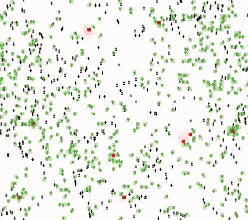
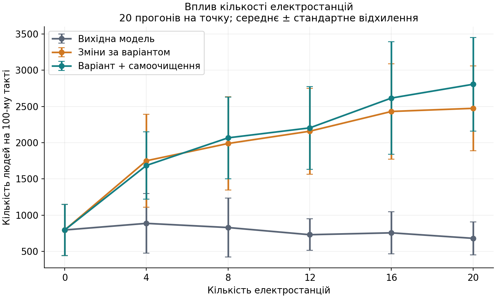
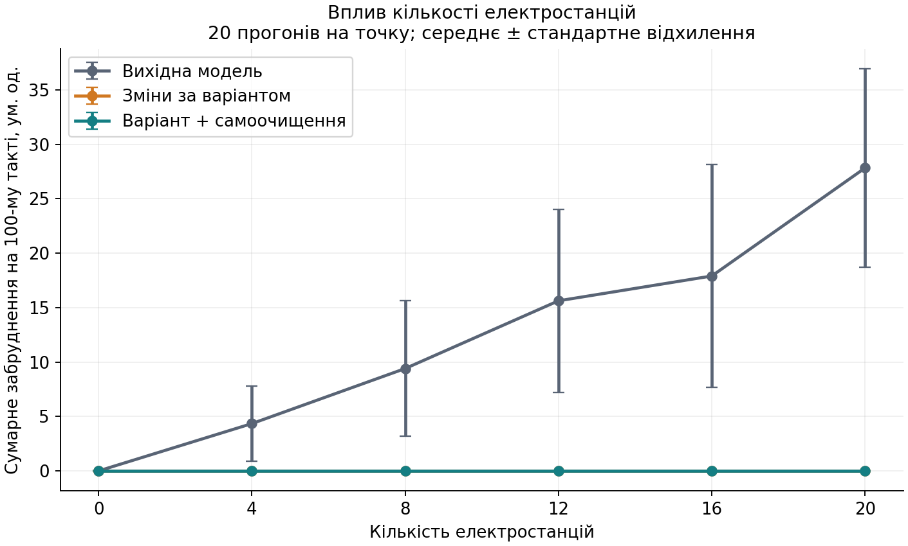

## Комп'ютерні системи імітаційного моделювання
## Група: **СПм-25-1**, **Волинець К.М.**

Викладач: **Іващенко Г. С.**
### Лабораторна робота №2. Редагування імітаційних моделей у середовищі NetLogo

<br>

### Варіант 4, модель у середовищі NetLogo

[Urban Suite — Pollution](https://www.netlogoweb.org/launch#https://www.netlogoweb.org/assets/modelslib/Curricular%20Models/Urban%20Suite/Urban%20Suite%20-%20Pollution.nlogo)

**Мета роботи:** ознайомитися із синтаксисом NetLogo, змінити логіку готової агентної моделі відповідно до завдання, додати власне вдосконалення та експериментально порівняти вихідну й модифіковану моделі.

### Короткий опис вихідної моделі

Модель містить людей (`people`), дерева (`trees`) та клітини простору (`patches`). Частина клітин є електростанціями. Люди випадково рухаються, втрачають здоров'я, розмножуються та саджають дерева. Забруднення погіршує здоров'я, а дерева його зменшують у своїй клітині й восьми сусідніх. Електростанції після дифузії встановлюють у власних клітинах заданий рівень `polluting-rate`.

У початковій версії електростанції мають лише негативний екологічний вплив. Імовірність народження визначається виключно `birth-rate`, а ймовірність посадки дерева однакова на всій території. Природного зменшення забруднення немає: його усувають лише дерева, окрім можливого перезаписування значення у клітині джерела.

У роботі використано ту саму модель з бібліотеки NetLogo/models `6.4.0`, що й у лабораторній №1. Простір залишено без змін: **71 × 63 клітини**, замикання по обох осях.

### Внесені зміни у вихідну логіку моделі, за варіантом

#### 1. Позитивний вплив електростанцій на появу нових людей

Електростанції забезпечують умовний інфраструктурний ефект: доступ до енергії покращує умови для появи нових людей. У моделі це реалізовано через додатковий бонус до ймовірності розмноження. Це спрощене припущення для навчального дослідження, а не встановлений демографічний закон.

Додано глобальну змінну `plant-count`. Після створення електростанцій у `setup` зберігається їх фактична кількість:

```netlogo
set plant-count count patches with [ is-power-plant? ]
```

Це дозволяє не перераховувати всі клітини для кожної людини на кожному такті та не плутати поточне положення повзунка з кількістю вже створених джерел. При зміні `power-plants` нове розміщення створюється лише після повторного `setup`.

Замість використання лише `birth-rate` додано репортер:

```netlogo
to-report effective-birth-rate
  let benefit energy-bonus * plant-count / (plant-count + 5)
  report min (list 1 (max (list 0 (birth-rate + benefit))))
end
```

Ймовірність визначається формулою:

**p = min(1; max(0; birth-rate + energy-bonus · K / (K + 5)))**, де K — фактична кількість електростанцій.

За відсутності станцій бонус дорівнює нулю; при K = 5 досягається половина максимального бонусу. Подальше збільшення K дає дедалі менший додатковий приріст. Значення 5 — внутрішня константа насичення, обрана як навчальне припущення. Насичення обмежує бонус, але не встановлює верхню межу чисельності населення.

Оновлена процедура розмноження:

```netlogo
to reproduce
  if health > 4 and random-float 1 < effective-birth-rate [
    hatch-people 1 [ set health 5 ]
  ]
end
```

Умова достатнього здоров'я **`health > 4`** збережена. Таким чином, позитивний ефект інфраструктури не скасовує вплив забруднення та старіння. За `birth-rate = 0.10`, `energy-bonus = 0.01`, K = 10 фактична ймовірність становить приблизно **0,10667**, тобто 10,667% замість 10%. Бонус є доданком до ймовірності, а не множником і не відсотком від початкового значення.

#### 2. Підвищена ймовірність посадки дерев поблизу електростанцій

До `patches-own` додано логічну змінну **`near-power-plant?`**. Вона істинна, якщо хоча б одна з восьми сусідніх клітин містить електростанцію. Карта близькості обчислюється один раз у `setup`, оскільки станції надалі не переміщуються:

```netlogo
with-local-randomness [
  ask patches [
    set near-power-plant? (any? neighbors with [ is-power-plant? ])
  ]
]
```

`with-local-randomness` зберігає зовнішній стан генератора випадкових чисел: допоміжне обчислення карти не змінює подальшу випадкову послідовність симуляції. Це важливо для перевірки еквівалентності з вихідною моделлю при вимкнених доповненнях.

Поблизу означає саме **вісім сусідніх клітин**, включно з діагональними. Власна клітина електростанції не отримує пріоритет автоматично; вона отримує його лише тоді, коли поряд є інша станція. На замкненому світі сусіди враховуються також через його межу. Перекриття зон кількох станцій не множить бонус повторно.

Додано репортер локальної ймовірності:

```netlogo
to-report local-planting-rate
  let probability planting-rate
  if near-power-plant? [
    set probability probability * near-plant-multiplier
  ]
  report min (list 1 (max (list 0 probability)))
end
```

Змінна клітини доступна людині як властивість клітини, на якій вона перебуває. Перевірка виконується після переміщення, тому дерево саджається з урахуванням нового місця агента.

```netlogo
to maybe-plant
  if random-float 1 < local-planting-rate [
    hatch-trees 1 [
      set health 5
      set color green
    ]
  ]
end
```

За `planting-rate = 0.05` та `near-plant-multiplier = 5` шанс посадки становить **25% поблизу станції** і **5% поза її околицями**. Імовірність обмежена інтервалом [0; 1]. Агент може посадити не більше одного дерева за такт; можливість існування кількох дерев на клітині з вихідної моделі збережена.

### Внесені зміни у вихідну логіку моделі, на власний розсуд

#### Природне самоочищення середовища

Додано керований параметр **`pollution-decay-rate`**, що визначає частку забруднення, яка природно зникає за один такт. Він узагальнено представляє розпад або вилучення забруднювача з модельованого середовища. Це не зміна дифузії: дифузія переносить речовину між клітинами, тоді як самоочищення зменшує її загальну кількість.

У процедуру `pollute` перед відновленням значення на електростанції додано один рядок:

```netlogo
to pollute
  set pollution pollution * (1 - pollution-decay-rate)
  if is-power-plant? [
    set pcolor red
    set pollution polluting-rate
  ]
  set pcolor scale-color red (pollution - .1) 5 0
end
```

За значення 0,02 клітина перед роботою джерел зберігає 98% свого забруднення. Без джерел, дерев і просторового перенесення через t тактів залишиться `P(0) · 0.98 ^ t`. На клітинах електростанцій після цього, як і раніше, встановлюється `polluting-rate`: природне самоочищення не вимикає джерело.

Послідовність обробки середовища: **дифузія → природне самоочищення → відновлення забруднення електростанціями → очищення деревами**. Порядок дій людей, поріг шкідливого забруднення, рух та зменшення здоров'я залишено без змін. За `pollution-decay-rate = 0` власне доповнення вимикається.

### Нові елементи інтерфейсу

| Параметр | Діапазон; крок | Значення за замовчуванням | Зміст |
|---|---|---:|---|
| `energy-bonus` | 0–0,02; 0,001 | 0,01 | Граничний додатковий шанс народження завдяки інфраструктурі |
| `near-plant-multiplier` | 1–10; 1 | 5 | Множник імовірності посадки на сусідніх зі станціями клітинах |
| `pollution-decay-rate` | 0–0,10; 0,01 | 0,02 | Частка природного вилучення забруднення за такт |

Праворуч від поля додано три повзунки та монітори фактичної кількості станцій, ефективної ймовірності народження, кількості пріоритетних клітин і сумарного забруднення. Нові керуючі змінні створюються повзунками, тому **не дублюються у `globals`**.

Для дослідження служить додаткова глобальна змінна `experiment-seed`. Вона використовується лише перед `setup` для встановлення генератора випадкових чисел. У звичайному запуску кнопками `setup` і `go` задавати її не потрібно.

Оригінальні значення повзунків збережені: `initial-population = 30`, `birth-rate = 0.10`, `planting-rate = 0.05`, `power-plants = 2`, `polluting-rate = 3`. У порівняльному експерименті використано інші явно наведені нижче початкові умови.



На зображенні — **реальний експорт поля NetLogo** командою `export-view`, а не макет інтерфейсу. Умови знімка: 30 початкових людей, 10 станцій, `birth-rate = 0.10`, `planting-rate = 0.05`, `polluting-rate = 3`, нові параметри 0,01 / 5 / 0,02, початкове значення генератора 1001; час — 50 тактів. Чорні фігурки — люди, зелені — дерева; червонуваті клітини показують забруднення. Це окремий демонстраційний запуск, не рядок основного експерименту.

Фінальна модель з кодом, інтерфейсом і вбудованими експериментами: [Urban-Suite-Pollution-Lab2.nlogo](Urban-Suite-Pollution-Lab2.nlogo). Відкрити у **NetLogo 6.4.0**, натиснути `setup`, потім `go`. Для перегляду всіх нових елементів за потреби розгорнути вікно. Повний код міститься у цьому ж `.nlogo`-файлі та доступний у вкладці **Code**. Редагування виконують безпосередньо в NetLogo; після змін потрібно натиснути **Check**, а потім **File → Save**. Зовнішні файли коду та скрипти збирання для роботи моделі не потрібні.

<br>

## Обчислювальний експеримент

### Вплив кількості електростанцій на населення та забруднення до і після змін

**Мета:** встановити, як модифікація логіки змінює залежність чисельності населення й сумарного забруднення від кількості електростанцій.

**Гіпотеза:** у вихідній моделі станції не дають позитивного демографічного ефекту. Після модифікації бонус до народжуваності та цілеспрямована посадка дерев можуть компенсувати шкоду від забруднення, через що залежність чисельності від кількості джерел зміниться.

#### Початкові умови та план

Спільні умови всіх трьох сценаріїв:

- `initial-population = 100`;
- `birth-rate = 0.10`;
- `planting-rate = 0.05`;
- `polluting-rate = 3`;
- світ — 71 × 63 клітини; дерев спочатку немає;
- здоров'я нових людей та дерев — 5;
- тривалість — **100 тактів**;
- досліджуваний параметр: **`power-plants = 0, 4, 8, 12, 16, 20`**;
- **20 повторень** для кожної комбінації сценарію та кількості станцій; значення генератора **1001–1020**.

| Сценарій | Версія моделі | `energy-bonus` | `near-plant-multiplier` | `pollution-decay-rate` |
|---|---|---:|---:|---:|
| Вихідна модель | Оригінальний алгоритм, як у лабораторній №1 | — | — | — |
| Зміни за варіантом | Бонус до народження та пріоритетна посадка | 0,01 | 5 | 0 |
| Повна модифікація | Зміни за варіантом і власне доповнення | 0,01 | 5 | 0,02 |

У межах кожного сценарію змінюється тільки кількість станцій. Між сценаріями навмисно змінюється досліджувана логіка. Сценарій «зміни за варіантом» дозволяє відокремити обов'язкові зміни від природного самоочищення. При цьому він не розділяє внески двох обов'язкових змін між собою.

Розрахунки **фактично виконано у NetLogo 6.4.0 через BehaviorSpace**, без переписування симуляції іншою мовою. Виконано **3 × 6 × 20 = 360 дослідницьких прогонів**. Усі досягли 100-го такту без дострокового зникнення людей. Вихідну модель також запущено заново; її результати збіглися з відповідною серією лабораторної №1.

Вимірювання: **N(100) = `count people`**, **P(100) = `sum [pollution] of patches`**. Кількість дерев збережено як допоміжний показник у CSV. Вимірювання відбувається **після завершення такту**, зокрема після очищення деревами.

У таблицях наведено **середнє ± вибіркове стандартне відхилення** за 20 прогонами; дільник для дисперсії — 19. Відрізки на графіках відображають стандартне відхилення, а не довірчий інтервал. Це середнє між прогонами на фіксованому такті, а не середнє у часі. Однакові початкові значення генератора полегшують відтворення, але при різній логіці не гарантують однакових траєкторій агентів.

#### Результати: чисельність населення N(100)

| Електростанції | Вихідна модель | Зміни за варіантом | Повна модифікація |
|---:|---:|---:|---:|
| 0 | 795,85 ± 351,79 | 795,85 ± 351,79 | 795,85 ± 351,79 |
| 4 | 887,15 ± 412,39 | 1751,30 ± 639,66 | 1686,55 ± 465,55 |
| 8 | 829,70 ± 407,06 | 1989,40 ± 643,51 | 2067,50 ± 563,02 |
| 12 | 730,80 ± 217,60 | 2158,90 ± 592,91 | 2204,90 ± 570,14 |
| 16 | 756,50 ± 291,66 | 2431,60 ± 656,59 | 2616,70 ± 778,03 |
| 20 | 680,75 ± 226,75 | 2474,65 ± 585,22 | 2807,00 ± 645,27 |



У вихідній моделі середня чисельність на крайніх точках зменшилася з **795,85** до **680,75** людей, однак проміжні значення немонотонні, а випадковий розкид великий. Отже, не можна стверджувати, що кожне додавання станцій обов'язково знижує чисельність в окремому прогоні.

Після змін за варіантом середнє N(100) зросло з **795,85** при 0 станцій до **2474,65** при 20. Для повної модифікації — до **2807,00**. Для обох модифікованих сценаріїв середні значення у вибраних точках зростають монотонно. При 20 станціях це приблизно **3,64 раза** та **4,12 раза** більше, ніж у вихідній моделі за тієї самої кількості джерел.

Такий результат узгоджується з новою логікою: навіть невеликий додатковий шанс народження накопичує ефект у кількох поколіннях, а посадка дерев біля станцій зменшує шкідливий вплив джерел. Оскільки обов'язкові зміни увімкнено разом, цей експеримент оцінює їх сукупний вплив.

#### Результати: сумарне забруднення P(100)

| Електростанції | Вихідна модель | Зміни за варіантом | Повна модифікація |
|---:|---:|---:|---:|
| 0 | 0,00 ± 0,00 | 0,00 ± 0,00 | 0,00 ± 0,00 |
| 4 | 4,35 ± 3,43 | 0,00 ± 0,00 | 0,00 ± 0,00 |
| 8 | 9,40 ± 6,23 | 0,00 ± 0,00 | 0,00 ± 0,00 |
| 12 | 15,62 ± 8,41 | 0,00 ± 0,00 | 0,00 ± 0,00 |
| 16 | 17,90 ± 10,23 | 0,00 ± 0,00 | 0,00 ± 0,00 |
| 20 | 27,83 ± 9,11 | 0,00 ± 0,00 | 0,00 ± 0,00 |



У вихідній моделі середній показник зростає від **0** до **27,83**. В обох модифікованих сценаріях **P(100) практично дорівнює нулю**: найбільший залишок серед прогонів становить приблизно **3,12 × 10⁻¹²** для змін за варіантом та **5,31 × 10⁻¹⁵** для повної модифікації. У таблиці ці малі значення та їх стандартні відхилення округлено до 0,00. Тому дві відповідні криві на графіку збігаються.

Причина — поєднання більшої кількості людей, посадки дерев біля джерел і правил очищення: у клітині може бути кілька дерев, кожне очищує також сусідів, а очищення виконується після встановлення забруднення електростанціями. До 100-го такту його вистачає для практично повного прибирання наявного забруднення в цих умовах. Наприклад, при 20 станціях середня кількість дерев становить 1737,50 у вихідній моделі, 5041,45 після обов'язкових змін і 5707,25 у повній модифікації.

**Практично нульовий рівень на 100-му такті не означає, що джерела не працюють або що забруднення не існувало раніше.** Значення на джерелах відновлюється кожного такту; раніше дерева ще могли бути нечисленними. На демонстраційному експорті поля на 50-му такті забруднення зберігається. Також після повного очищення воно може виникнути знову через зміну розміщення та кількості дерев.

#### Оцінка власного доповнення та висновки

При 20 станціях середнє N(100) для повної модифікації вище за сценарій лише з обов'язковими змінами на **332,35 людини**, або приблизно **13,4%**. Проте при 4 станціях воно, навпаки, трохи нижче; розкид в обох сценаріях значний. Без окремого статистичного аналізу такі різниці не слід подавати як доведений демографічний ефект самоочищення для кожного значення параметра.

Показник P(100) також не дозволяє розрізнити ці два сценарії: в обох він наблизився до нижньої межі 0. Для детальнішого дослідження власного доповнення доцільно було б аналізувати накопичене забруднення за весь прогін або менший рівень посадки дерев. У межах цієї роботи дію самоочищення додатково перевірено ізольовано на клітині з відомим рівнем забруднення.

**Висновок експерименту:** внесення позитивного інфраструктурного ефекту та локального пріоритету посадки змінило характер залежності N(100) від кількості електростанцій: замість слабкої немонотонної спадної тенденції між крайніми точками отримано зростання середніх значень. Водночас для модифікованих моделей кінцеве забруднення стало практично нульовим в усіх досліджених умовах.

Ці висновки стосуються конкретних параметрів і горизонту 100 тактів. Модель не враховує вартості посадки, дефіциту місця, обмеженості ресурсів і реальної фізики очищення. Тому результат не означає, що необмежене будівництво електростанцій завжди корисне для реального міста, і не визначає оптимальну кількість станцій.

## Перевірка реалізації

Виконано окремі перевірки у NetLogo; результати записано в `data/validation.txt`:

- фактична кількість створених станцій і правильність формули бонусу;
- відсутність бонусу при 0 станцій, обмеження ймовірностей значенням 1;
- рівно 8 пріоритетних клітин навколо одиночної станції;
- імовірності посадки 0,25 поблизу станції та 0,05 далеко від неї;
- збереження заборони розмноження при `health = 4`;
- перетворення забруднення 2 на 1,96 за самоочищення 0,02, збереження нуля та відновлення рівня на джерелі;
- невід'ємність забруднення й відсутність агентів із вичерпаним здоров'ям після завершення такту;
- **п'ять контрольних прогонів** при 8 станціях, початкових значеннях генератора 1001–1005 і нових параметрах **0 / 1 / 0** точно збіглися з оригіналом за часом, чисельністю людей, кількістю дерев і сумарним забрудненням на 100-му такті.

Остання перевірка підтверджує можливість вимкнення доповнень на перевірених випадках, але не є формальним доказом для всіх можливих станів. Контрольні та демонстраційний запуски не входять у 360 прогонів основного експерименту.

## Відповіді на контрольні запитання

1. **Підходи до імітаційного моделювання.** Агентне моделювання описує поведінку окремих агентів і їх взаємодію; дискретно-подійне — події, що змінюють стан системи; системна динаміка — агреговані накопичувачі, потоки й зворотні зв'язки. Можливі гібридні підходи.
2. **Види агентів NetLogo.** `turtles` — рухомі агенти; `patches` — нерухомі клітини світу; `links` — зв'язки між turtles; `observer` — спостерігач, який керує моделлю загалом.
3. **Як створити процедуру та функцію?** Командну процедуру визначають через `to назва ... end`, а репортер, що повертає значення, — через `to-report назва ... report значення ... end`. Аргументи записують у квадратних дужках після назви, наприклад `to-report twice [x] report 2 * x end`.
4. **Як вивести повідомлення?** `user-message "Повідомлення"` відкриває діалог; `print "Повідомлення"` пише у Command Center; `show` також указує агента-виконавця; `output-print` виводить текст в елемент Output інтерфейсу.
5. **Як установити змінну?** `set health 5` змінює наявну змінну. `let value 5` створює локальну змінну та задає її початкове значення.
6. **Як реалізуються цикли?** `repeat 10 [ ... ]` — задана кількість повторень; `while [умова] [ ... ]` — поки умова істинна; `foreach список [x -> ...]` — обхід списку; `loop [ ... ]` — повторення до виходу, наприклад через `stop`. Обхід агентів виконують через `ask`.
7. **Що описують `turtles-own` і `globals`?** `turtles-own [health]` оголошує змінну, окреме значення якої має кожна turtle. `globals [plant-count]` оголошує спільну змінну моделі. Для клітин є `patches-own`, а для конкретного типу — наприклад `people-own`.
8. **Навіщо `ask`?** Виконує блок команд від імені агента або кожного агента з набору: `ask people [fd 1]`. Для agentset порядок обходу випадковий; `self` усередині блоку означає поточного виконавця.
9. **Як створити, ідентифікувати й видалити активних агентів?** `create-turtles 10` створює 10 turtles у контексті observer; `sprout 1` створює turtle з клітини. Початково доступні `who`, координати, `heading`, `color`, `shape`, `size` та оголошені власні змінні. Звичайні `create-turtles` з'являються в (0, 0) із випадковими напрямками й кольорами; координати можна одразу змінити в блоці створення. Ідентифікатор — `who`, отримання агента — `turtle 0`, видалення — `ask turtle 0 [die]`, якщо такий агент існує.
10. **Як створити різнорідних агентів?** Оголосити типи: `breed [people person]`, `breed [trees tree]`; далі використовувати `create-people`, `create-trees` або відповідні команди `hatch` і `sprout`. Типи можуть мати різні форми, властивості й процедури поведінки.
11. **Для чого `hatch`?** Створює нащадків поточної turtle, які успадковують її властивості, але отримують нові `who`. Наприклад, `hatch-people 1 [set health 5]` створює людину в позиції батьківського агента й задає нове здоров'я. `hatch-trees` дозволяє створити інший тип агента.
12. **Команди руху та напрямок.** `fd` / `forward` — вперед, `bk` / `back` — назад, `rt` і `lt` — повороти; `setxy` задає координати, `move-to` переміщує до агента або клітини, `face` повертає до цілі. `heading`: 0° — північ, 90° — схід, 180° — південь, 270° — захід.
13. **`random-pxcor` і `random-xcor`.** Перше повертає випадкову цілу x-координату клітини, друге — випадкову дійсну x-координату в допустимому діапазоні світу, не обов'язково в центрі клітини.
14. **Як установити колір клітини?** Наприклад, `ask patch 0 0 [set pcolor green]`; людина може змінити колір своєї клітини через `set pcolor green`. Колір turtle визначається окремо змінною `color`.
15. **Як перевірити агента попереду?** У контексті turtle: `let target patch-ahead 1`, потім `if target != nobody [if any? turtles-on target [ ... ]]`. Перевірка `nobody` потрібна для незамкненого світу біля межі.
16. **Як отримати випадкове число в діапазоні?** Ціле від a до b включно: `a + random (b - a + 1)` для цілих a ≤ b. Дійсне з [a; b): `a + random-float (b - a)` за a < b. `random-seed` задає відтворювану випадкову послідовність.
17. **`one-of` і `n-of`.** `one-of` обирає один випадковий елемент списку або агента; для порожнього agentset повертає `nobody`. `n-of n` обирає n елементів або агентів без повторного вибору тієї самої позиції/агента; n не може перевищувати розмір джерела. Порожній список для `one-of` є помилкою.
18. **Для чого `item`?** Повертає елемент списку або символ рядка за індексом, починаючи з нуля: `item 1 [10 20 30]` повертає 20.
19. **Як показати поточну кількість активних агентів?** Додати Monitor із репортером `count turtles` або для потрібного типу — `count people`. Команда `show count turtles` виводить число у Command Center. `count turtles` у цій моделі включає також дерева.
20. **Як перейти до наступного такту?** `reset-ticks` ініціалізує час нулем, `tick` збільшує лічильник на 1 й оновлює графіки. Зазвичай `reset-ticks` викликають наприкінці `setup`, а `tick` — наприкінці `go`.