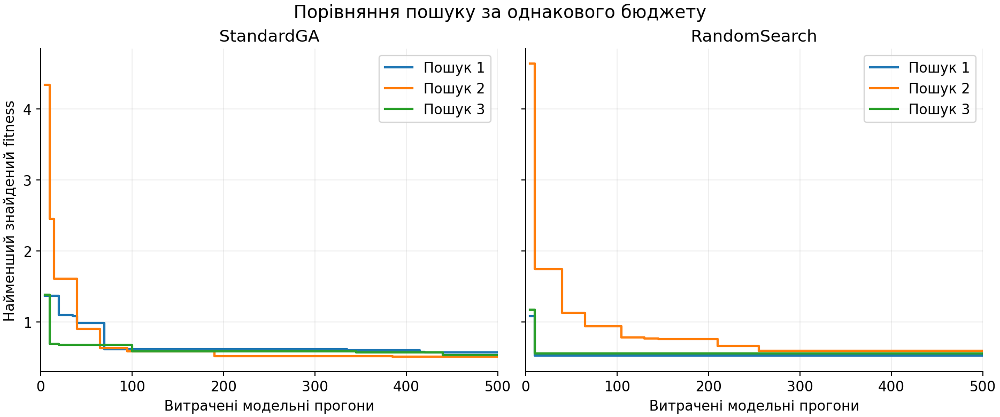
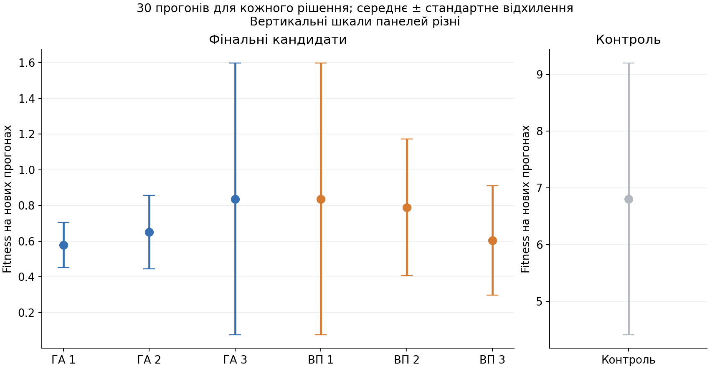
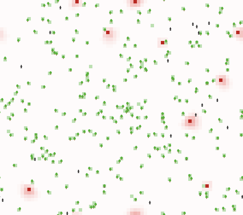
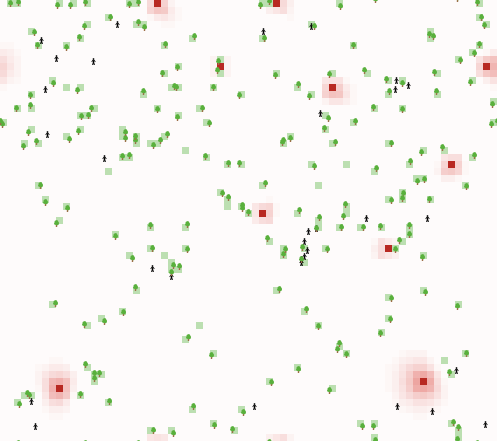

## Комп'ютерні системи імітаційного моделювання
## Група: **СПм-25-1**, **Волинець К.М.**

Викладач: **Іващенко Г. С.**
### Лабораторна робота №3. Використання засобів обчислювального інтелекту для оптимізації імітаційних моделей

<br>

### Варіант 4 — Urban Suite — Pollution

[Модель у бібліотеці NetLogo](https://ccl.northwestern.edu/netlogo/models/UrbanSuite-Pollution)

**Мета:** налаштувати параметри імітаційної моделі за допомогою BehaviorSearch, порівняти простий генетичний алгоритм `StandardGA` з випадковим пошуком `RandomSearch` та перевірити знайдені рішення в NetLogo.

### Використана модель та показники

Використано **базову версію** Urban Suite — Pollution, досліджену в лабораторній №1. Методичні вказівки дозволяють використовувати як базову, так і модифіковану версію. Доповнення з лабораторної №2 тут не застосовуються.

Люди (`people`) переміщуються, втрачають здоров'я, можуть створювати нащадків і саджати дерева. Електростанції є клітинами (`patches`) із позначкою `is-power-plant?`. Забруднення поширюється дифузією; його підвищені значення погіршують здоров'я людей. Дерева очищують власну клітину та вісім сусідніх. Простір — 71 × 63 клітини із замиканням по обох осях.

Важлива особливість: електростанція кожного такту **встановлює** забруднення своєї клітини в `polluting-rate`, а не додає фіксовану кількість речовини. Після цього дерева можуть зменшувати забруднення, у тому числі на джерелах.

| Керуючий параметр | Зміст |
|---|---|
| `initial-population` | Чисельність населення після `setup` |
| `birth-rate` | Імовірність народження за такт для людини зі здоров'ям понад 4 |
| `planting-rate` | Імовірність посадки одного дерева людиною за такт |
| `power-plants` | Кількість електростанцій, що створюються при `setup` |
| `polluting-rate` | Рівень забруднення, який встановлюється в клітині електростанції |

Показники: чисельність людей N(t), кількість дерев T(t), сумарне забруднення P(t), середнє забруднення клітини P(t)/4473. Для оптимізації додано складений показник втрат `policy-loss`.

### Постановка задачі оптимізації

Потрібно знайти початкову чисельність населення, ймовірності народження та посадки дерев, за яких у другій половині 100-тактового прогону населення утримується поблизу **100 людей**, забруднення невелике, а інтенсивність посадки не є надмірною.

Кількість станцій зафіксовано на рівні **10**, рівень забруднення джерел — **3**. Це зберігає екологічне навантаження в усіх рішеннях. Мінімізація лише забруднення зі змінними джерелами могла б дати тривіальне рішення: нуль станцій або нульовий рівень їх забруднення.

Використано безрозмірний складений критерій:

**L(t) = |N(t) − 100| / 100 + P(t) / 4473 + 2 · planting-rate.**

- Перший доданок штрафує як нестачу, так і надлишок людей відносно цілі 100.
- Другий доданок — середнє забруднення клітини в умовних одиницях.
- Третій — умовний штраф за інтенсивність посадки; при `planting-rate = 0.10` він дорівнює 0,20.

Нормування забруднення тут означає усереднення на клітину; його фізичні одиниці модель не задає. Доданки об'єднано в умовну оцінку з явно заданими вагами. Вага 2 і ціль 100 — **навчальні припущення**, а не емпірично встановлені економічні нормативи. Штраф посадки не є фактичними грошовими витратами або кількістю посаджених дерев. Інші ваги можуть змінити знайдене рішення.

Якщо населення зникло, `policy-loss` повертає **10**. Це дає великий штраф для неприйнятного стану й не дозволяє трактувати вимирання як успішне очищення середовища.

```netlogo
to-report policy-loss
  if not any? people [ report 10 ]
  report (abs (count people - 100) / 100
    + mean [ pollution ] of patches
    + 2 * planting-rate)
end
```

Функція пристосованості — середнє L(t) за тактами **51–100 включно**, далі середнє за **п'ятьма новими прогонами** при оцінюванні кандидата. Для повторно відвіданих кандидатів BehaviorSearch може накопичувати повторення, що окремо враховано під час аналізу журналів. Менше значення означає кращий результат. Усереднення показника відхилення в часі штрафує коливання навколо цілі, а не лише невдалу кінцеву чисельність.

### Технічна підготовка моделі

Екологічні процедури вихідної моделі збережені. Додано репортер `policy-loss`, монітори критерію і середнього забруднення та технічну змінну `validation-seed` для відтворюваної перевірки.

Оригінальна `go` зупиняється при зникненні людей. Щоб усі кандидати оцінювалися на однаковому часовому інтервалі, BehaviorSearch викликає обгортку:

```netlogo
to search-step
  ifelse any? people [ go ] [ tick ]
end
```

Поки люди існують, виконується оригінальна логіка. Після вимирання стан середовища залишається термінальним, рухається лише лічильник часу, а критерій дорівнює 10. Це технічна домовленість для оцінювання, а не моделювання екологічних процесів після зникнення людей. Завдяки їй завжди доступні всі 50 вимірювань на тактах 51–100.

Крок повзунків `birth-rate` та `planting-rate` зменшено до 0,005, щоб знайдені значення можна було встановити і через інтерфейс NetLogo.

## Налаштування BehaviorSearch

Використано **BehaviorSearch 1.10**, що входить до **NetLogo 6.4.0**. Пошук фактично виконано його штатним рушієм у headless-режимі. Python використано лише для запуску, обробки результатів і графіків; алгоритми пошуку іншою мовою не переписувалися.

Протоколи можна відкрити у віконній версії BehaviorSearch:

- [StandardGA.bsearch](StandardGA.bsearch);
- [RandomSearch.bsearch](RandomSearch.bsearch).

### Вкладка Model

Модель: [Urban-Suite-Pollution-Lab3.nlogo](Urban-Suite-Pollution-Lab3.nlogo). У протоколах шлях відносний: файл моделі має лежати поруч із `.bsearch`.

Параметри простору пошуку:

```text
["initial-population" [30 10 100]]
["birth-rate" [0.05 0.005 0.10]]
["planting-rate" [0 0.005 0.10]]
["power-plants" 10]
["polluting-rate" 3]
```

У трійці чисел використано порядок **[мінімум крок максимум]**.

| Параметр | Діапазон | Крок | Кількість значень |
|---|---|---:|---:|
| `initial-population` | 30–100 | 10 | 8 |
| `birth-rate` | 0,05–0,10 | 0,005 | 11 |
| `planting-rate` | 0–0,10 | 0,005 | 21 |

Простір містить **8 × 11 × 21 = 1848 комбінацій**. Діапазон народжуваності обмежено областю не вище стандартного значення 0,10; модель дозволяє й більші значення, але вони не входять до цієї задачі. Оптимізується також початкова умова — `initial-population`, а не тільки правила поведінки агентів.

| Поле Model | Значення |
|---|---|
| Setup | `setup` |
| Go / Step | `search-step` |
| Measure | `policy-loss` |
| Measure if | `ticks >= 51` |
| Stop if | порожнє |
| Step limit | 100 |

### Вкладка Search Objective

| Поле | Значення |
|---|---|
| Goal | **Minimize Fitness** |
| Collected measure | `MEAN_ACROSS_STEPS` |
| Sampling | Fixed Sampling, **5 replicates** |
| Combine replicates | `MEAN` |
| Take derivatives | вимкнено |

П'ять повторень зменшують вплив випадкових розміщень, руху, народжень і посадки дерев, але не усувають його. Тому результати пошуку нижче додатково перевіряються на нових початкових значеннях генератора.

### Вкладка Search Algorithm

| Налаштування | StandardGA | RandomSearch |
|---|---|---|
| Search Space Encoding | `GrayBinaryChromosome` | `GrayBinaryChromosome` |
| Evaluation limit | **500 model runs** | **500 model runs** |
| Use fitness caching | вимкнено | вимкнено |
| Best-checking replicates | 0 | 0 |
| Population size | 20 | — |
| Tournament size | 3 | — |
| Crossover rate | 0,70 | — |
| Mutation rate | 0,05 на біт | — |
| Population model | `generational` | — |

**Evaluation limit — це ліміт запусків моделі, а не кількість поколінь ГА.** За п'яти повторень на кандидата бюджет 500 дає 100 оцінювань кандидатів. У ГА з популяцією 20 це п'ять оцінених популяцій: початкова та чотири наступні. У випадковому пошуку — 100 випадкових кандидатів. Повторні кандидати можливі, тому це не обов'язково 100 різних комбінацій.

Кешування вимкнене для однакового явного обліку бюджету та повторної оцінки випадкових результатів. Для стохастичної моделі кешування може впливати не тільки на швидкість: воно зберігає попередню оцінку замість нового випадкового вимірювання.

Кодування Грея подає параметри бітовими послідовностями. Мутація змінює біти з імовірністю 0,05; турнірний відбір обирає батьків із груп по три кандидати; кросовер поєднує їх кодування. Параметри ГА зафіксовано до аналізу результатів; окрему оптимізацію самого ГА не проводили.

### Налаштування запуску

| Поле | Значення |
|---|---|
| Number of searches | **3 для кожного алгоритму** |
| Starting search ID | 1 |
| Initial random seed | 20261022; наступні пошуки — 20261023 і 20261024 |
| Number of threads | 2 |
| Brief output | вимкнено |
| Output file stem | `data/ga` та `data/rs` |

Разом основний пошук містить **2 × 3 × 500 = 3000 запусків моделі**, або 600 оцінювань кандидатів. Повний перебір 1848 комбінацій по п'ять разів потребував би 9240 прогонів. Кожен окремий пошук використав близько 5,4% такого бюджету, але це не означає рівномірного покриття 5,4% простору: кандидати можуть повторюватися.

## Результати пошуку

| Метод | Пошук | Початкове населення | birth-rate | planting-rate | Найкращий fitness | Повторень в оцінці | Різних кандидатів |
|---|---:|---:|---:|---:|---:|---:|---:|
| StandardGA | 1 | 40 | 0,085 | 0,045 | 0,5706 | 15 | 74 |
| StandardGA | 2 | 50 | 0,085 | 0,035 | 0,5051 | 5 | 58 |
| StandardGA | 3 | 30 | 0,085 | 0,050 | 0,5323 | 5 | 57 |
| RandomSearch | 1 | 30 | 0,085 | 0,050 | 0,5218 | 5 | 98 |
| RandomSearch | 2 | 50 | 0,090 | 0,025 | 0,5943 | 5 | 98 |
| RandomSearch | 3 | 30 | 0,090 | 0,065 | 0,5511 | 5 | 97 |

Значення fitness у цій таблиці — оцінки, які алгоритми бачили під час пошуку. Вони можуть бути оптимістичними через вибір найменшого результату серед багатьох випадкових оцінок. Найкраще знайдене рішення не називається доведеним глобальним оптимумом.



На графіку зображено найменшу знайдену до поточного моменту оцінку для кожного з трьох пошуків. Горизонтальна вісь — витрачені модельні прогони, вертикальна — fitness, який мінімізується. Порівнюється якість за однакового бюджету, а не швидкість у секундах; процеси виконувалися паралельно, тому часові заміри не використовувалися для висновків про алгоритми.

Середнє найкращих пошукових оцінок за трьома повтореннями становить **0,5360 для StandardGA** та **0,5557 для RandomSearch**. Найнижча окрема оцінка — **0,5051**, її знайшов ГА в пошуку 2; найкращий випадковий пошук — **0,5218** у повторенні 1. Це невелика перевага ГА на пошукових даних, яка сама по собі ще не доводить переваги на нових прогонах.

У журналі BehaviorSearch оцінювання повторно відвіданого кандидата може накопичувати повторення: наприклад, у фінальному записі GA1 поле `num-replicates` дорівнює 15. Кожне нове звернення витрачало п'ять нових прогонів, але запис найкращого fitness відображає оцінку, за якої було зафіксовано покращення; це не обов'язково середнє всіх пізніших прогонів того самого кандидата. Саме тому для порівняння потрібна незалежна перевірка.

## Перевірка знайдених параметрів у NetLogo

Кожен із шести фінальних кандидатів перевірено на **30 нових прогонах**, із початковими значеннями генератора **30001–30030**. Той самий набір значень використано для контрольного сценарію: `initial-population = 100`, `birth-rate = 0.10`, `planting-rate = 0.05`, станцій 10, `polluting-rate = 3`. Це контроль при заданому екологічному навантаженні, а не повний набір стандартних налаштувань моделі.

Отже, додаткова перевірка містить **7 × 30 = 210 прогонів**. Підсумкові оцінки отримано незалежно від випадкових прогонів пошуку, за тим самим критерієм і часовим вікном. Наведено середнє ± вибіркове стандартне відхилення, а не довірчий інтервал. Для кожного алгоритму кандидат для основного порівняння обирається за найкращим **пошуковим** fitness, до перегляду перевірних результатів.

| Рішення | Fitness, середнє ± s | Середнє N(100) | Середнє забруднення клітини, такти 51–100 | Вимирання до 100-го такту |
|---|---:|---:|---:|---:|
| GA1 | 0,5785 ± 0,1268 | 31,77 | 0,0371 | 0/30 |
| GA2 | 0,6510 ± 0,2052 | 42,93 | 0,0351 | 1/30 |
| GA3 | 0,8364 ± 0,7604 | 26,73 | 0,0419 | 3/30 |
| RS1 | 0,8364 ± 0,7604 | 26,73 | 0,0419 | 3/30 |
| RS2 | 0,7898 ± 0,3828 | 81,43 | 0,0381 | 0/30 |
| RS3 | 0,6035 ± 0,3063 | 42,03 | 0,0267 | 1/30 |
| Контроль | 6,8045 ± 2,3924 | 728,83 | 0,0032 | 0/30 |



За пошуковими оцінками для основного порівняння обрано **GA2** та **RS1**. На нових даних вони отримали відповідно **0,6510 ± 0,2052** і **0,8364 ± 0,7604**. Для контролю результат — **6,8045 ± 2,3924**.

У вибраного рішення ГА втрати нижчі приблизно на **22,2%**, ніж у вибраного випадкового рішення, на цій перевірній вибірці. Вимирання зафіксовано у **1 із 30** прогонів GA2 та **3 із 30** прогонів RS1.

Поліпшення складеного критерію не означає поліпшення кожного його доданка. Середнє забруднення клітини в обраному рішенні ГА — **0,0351**, у випадкового пошуку — **0,0419**, а в контролі — лише **0,0032**. Контроль має набагато більше людей і дерев, але великий штраф за перевищення цільової чисельності. Отже, оптимізація знайшла компроміс, насамперед зменшивши надлишкову чисельність; екологічний показник відносно контролю погіршився.

Середнє N(100) становить лише **42,93** для GA2 та **26,73** для RS1. Тому не можна стверджувати, що мету стабільного утримання 100 людей виконано точно: критерій оцінює весь інтервал 51–100, а короткий пошук дає лише наближення.

GA3 та RS1 знайшли однаковий набір параметрів, тому на однакових перевірних початкових значеннях їх результати точно збігаються. GA1 на перевірці має нижче середнє, ніж вибраний GA2, але це спостереження вже отримано на перевірній вибірці; для незалежного підтвердження вибору GA1 знадобилася б нова вибірка. Значний розкид нагадує, що знайдений параметричний набір не забезпечує точно 100 людей у кожному прогоні. Три пошуки на алгоритм — мала кількість для загального висновку про статистичну перевагу методу; формального тесту такої переваги тут не проводили.

### Вигляд моделі при знайдених параметрах

**StandardGA, GA2:** `initial-population = 50`, `birth-rate = 0.085`, `planting-rate = 0.035`; `power-plants = 10`, `polluting-rate = 3`.



**RandomSearch, RS1:** `initial-population = 30`, `birth-rate = 0.085`, `planting-rate = 0.05`; `power-plants = 10`, `polluting-rate = 3`.



Зображення — справжній експорт поля NetLogo командою `export-view` на 100-му такті перевірного прогону з початковим значенням генератора 30001. Це знімки поля симуляції, а не штучно відтворені вікна програми. Чорні фігурки — люди, зелені — дерева; колір клітин відображає забруднення та ділянки очищення. Один знімок ілюструє окремий прогін, а статистичні висновки ґрунтуються на повтореннях.

## Висновки

Налаштовано та запущено два штатні алгоритми BehaviorSearch, визначено дискретний простір із 1848 комбінацій та складений критерій, який поєднує наближення населення до цілі, забруднення й інтенсивність посадки. Порівняння виконано за однакового бюджету та з трьома незалежними пошуками кожного методу.

На пошукових оцінках StandardGA мав кращий середній результат за три повторення (0,5360 проти 0,5557). Незалежна перевірка дала 0,6510 для вибраного рішення ГА та 0,8364 для вибраного рішення випадкового пошуку; контрольний сценарій — 6,8045. Ці перевірні оцінки, а не лише найкращі значення у процесі пошуку, характеризують якість знайдених налаштувань на нових прогонах.

Отримані налаштування є результатом оптимізації саме заданого критерію, ваг і горизонту. Вони не доводять стійкості системи на необмеженому часі та не є рекомендаціями щодо реальної демографічної чи екологічної політики. Для сильнішого висновку про перевагу алгоритму потрібні більше повторень пошуку та інші бюджети, задачі й налаштування.

## Відповіді на контрольні запитання

1. **Навіщо потрібна оптимізаційна модель?** Щоб знайти допустиме рішення, яке мінімізує або максимізує заданий критерій. Імітаційна модель оцінює наслідки вибору параметрів, а оптимізаційний метод шукає кращі значення.
2. **Етапи використання BehaviorSearch.** Вибрати модель; визначити діапазони параметрів; задати запуск, міру й часовий інтервал; налаштувати функцію пристосованості та повторення; вибрати алгоритм, кодування й бюджет; запустити пошук; перевірити знайдені параметри у NetLogo.
3. **Що таке цільова функція?** Числова оцінка якості кандидата. Вона перетворює вимоги до поведінки системи на критерій, за яким можна порівнювати набори параметрів.
4. **Простір пошуку.** Множина всіх допустимих наборів параметрів. У цій роботі це 1848 дискретних комбінацій трьох змінних при двох зафіксованих параметрах.
5. **Алгоритми BehaviorSearch.** У використаній версії доступні `RandomSearch`, `StandardGA`, `MutationHillClimber` і `SimulatedAnnealing`.
6. **Метод випадкового пошуку.** Генерує випадкові допустимі кандидати, оцінює їх і запам'ятовує найкращий. Не використовує структуру попередніх вдалих рішень для цілеспрямованого створення наступних.
7. **Середнє й медіана.** Середнє — сума значень, поділена на їх кількість; медіана — середина впорядкованої вибірки. Середнє сильніше реагує на крайні значення. У цій роботі великі втрати й вимирання важливі, тому їх не слід приховувати медіаною.
8. **Критерії зупинки пошуку.** Ліміт оцінювань або модельних прогонів, кількість поколінь, часовий ліміт, досягнення цільового значення, відсутність покращення. У роботі використано ліміт 500 модельних прогонів на один пошук.
9. **Етапи ГА.** Створення початкової популяції, оцінювання пристосованості, відбір батьків, кросовер і мутація, формування наступної популяції, повторення до критерію зупинки.
10. **Генетичні оператори.** Відбір, кросовер, мутація та механізми заміни популяції; часто використовують також елітизм — збереження найкращих особин. Наявність елітизму залежить від конкретної реалізації.
11. **Кросовер і відбір батьків.** Кросовер поєднує частини кодувань двох батьків у нащадку. Батьків можуть обирати турнірним, пропорційним або ранговим відбором. Тут застосовано турніри розміром 3.
12. **Навіщо мутація?** Вносить нові варіанти, підтримує різноманіття та допомагає виходити за межі комбінацій, уже представлених у популяції. Надто мала ймовірність сприяє передчасному зближенню особин, надто велика може руйнувати корисні структури.
13. **Способи кодування.** Бінарні рядки, код Грея, цілочислові або дійсні вектори, перестановки, змішане кодування. Вибір має відповідати параметрам і допустимим операторам. Тут використано `GrayBinaryChromosome`.
14. **Переваги й недоліки ГА.** Можуть працювати без похідних, із дискретними, нелінійними та багатомодальними задачами. Водночас потребують багатьох оцінювань, залежать від кодування й налаштувань, можуть передчасно збігатися та не гарантують глобального оптимуму. На малому бюджеті простий випадковий пошук може бути конкурентним.
15. **Імітація відпалу.** Пошук переходить до сусідніх рішень і може приймати гірші з імовірністю, залежною від величини погіршення та температури. Температура поступово знижується, зменшуючи готовність до таких переходів.
16. **Сходження до вершини.** Ітеративно перевіряє сусідні рішення та переходить до кращого; для мінімізації — у напрямку зменшення критерію. Може зупинятися в локальних оптимумах; випадкові перезапуски допомагають дослідити інші області.